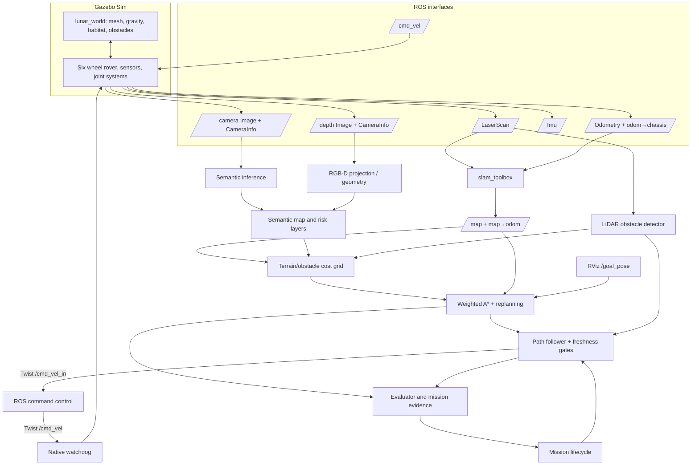
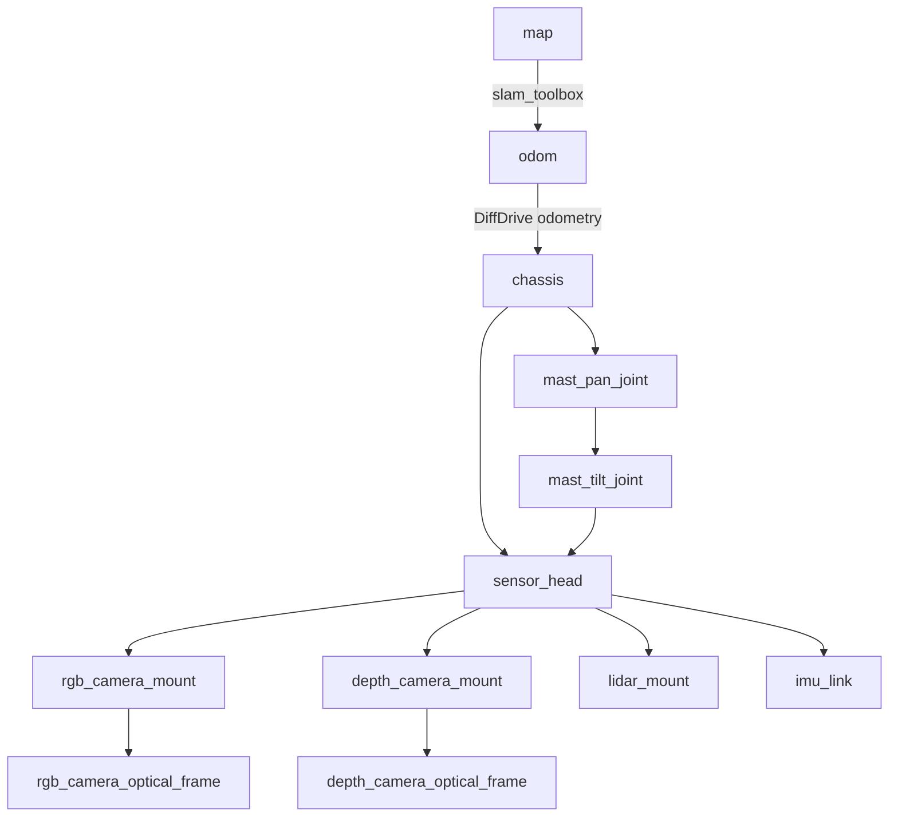

# LunaBot V4 System Architecture and Data Flow

## Scope and components

| Layer | Existing components | Evidence/status |
|---|---|---|
| Simulation | Gazebo Sim world, lunar mesh, habitat/rocks/obstacles, six-wheel articulated rover, sensors, DiffDrive and native command watchdog | SDF source in `src/lunabot_gazebo`; physics/sensor integration has multiple dated evidence runs. |
| ROS bridge | `ros_ign_bridge` / compatible `ros_gz_bridge`; simulation clock, sensors, odom, joint state, command and joint controllers | Phase-specific launch shell and source; supported Fortress profile. |
| Localization/map | `slam_toolbox`, occupancy grid `/map`, `map→odom`; DiffDrive odometry owns `odom→chassis` | P3-02 short-route qualification, saved map/graph tests. |
| Perception | RGB-D segmentation; calibrated projection; semantic, confidence, age, slope, roughness, crater risk and uncertainty layers | Active three-class model; P6 simulation calibration; ROS integration. |
| Obstacle/map | Real simulated LaserScan detector, occupancy overlay, markers and status | Phase L reports `OBSTACLE_DETECTED`; detector does not command motion. |
| Planner | Occupancy A* baseline; terrain weighted A*; dynamic map revision/replan; D* Lite only benchmark candidate | Planner fixture gates and bounded P8/P10 evidence. |
| Control/safety | Terrain path follower → `/cmd_vel_in` → `control_odometry.py` → `/cmd_vel` → native watchdog → DiffDrive | Fault-injection and controller boundary records; software safety only. |
| Mission/evaluation | Mission lifecycle supervisor, retained status, SQLite event store, scenario/evaluation nodes | P8 missions and Phase L mission event conditions; not physical sample handling. |
| Visualization | RViz phase configs, RobotModel/TF, map/scan/path/cost/semantic views per config | Configs exist; current inspected evidence lacks GUI screenshots. |

## End-to-end data flow



## Important interfaces

| Interface | Type | Producer → consumer | Role |
|---|---|---|---|
| `/lunabot/camera/image_raw` | `sensor_msgs/Image` | Gazebo bridge → segmentation/projection | RGB image. |
| `/lunabot/camera/camera_info` | `sensor_msgs/CameraInfo` | Gazebo bridge → projection | Intrinsics. |
| `/lunabot/depth/image_raw` | `sensor_msgs/Image` | Gazebo bridge → projection | 32FC1 depth in metres on audited stream. |
| `/lunabot/lidar/scan` | `sensor_msgs/LaserScan` | Gazebo bridge → SLAM/obstacle detector | 720-ray simulated scan. |
| `/lunabot/imu` | `sensor_msgs/Imu` | Gazebo bridge → diagnostic/possible future fusion | Simulated inertial measurement. |
| `/lunabot/odom` | `nav_msgs/Odometry` | DiffDrive bridge → planner/follower/SLAM | Wheel-derived local pose and twist. |
| `/map`, `/tf` | `OccupancyGrid`, `TFMessage` | SLAM / TF owners → mapping/planning/RViz | Global map and frame transforms. |
| `/lunabot/terrain/segmentation`, `/overlay` | `Image` | Segmentation → RViz / terrain mapper | Mask and visualization. |
| `/lunabot/terrain/semantic_map/*` | `OccupancyGrid` or status `String` (layer-specific) | Semantic mapper → cost mapper/RViz | Semantic and risk grids. |
| `/lunabot/obstacles/map` | `nav_msgs/OccupancyGrid` | LiDAR detector → cost/planner/follower | Recent obstacle grid. |
| `/lunabot/terrain/cost_map` | `nav_msgs/OccupancyGrid` | Cost mapper → weighted A* | Traversability penalties. |
| `/goal_pose` | `geometry_msgs/PoseStamped` | RViz operator or test input → planner/supervisor | Goal in map frame. |
| `/lunabot/terrain/plan` | `nav_msgs/Path` | Terrain planner → follower | Terrain-aware route. |
| `/cmd_vel_in` → `/cmd_vel` | `geometry_msgs/Twist` | Planner/follower → ROS controller → Gazebo | Only permitted actuator path. |
| `/lunabot/mission/command` → `/lunabot/mission/status` | `std_msgs/String` | Operator → supervisor → follower/evaluator | Lifecycle control and retained state. Not an action/service. |

Topic graph is phase dependent; `evidence/runs/terrain-goal-20261116-recheck/topics.txt` is a captured Phase L list. See `docs/interfaces.md`, `docs/safety-control.md`, `docs/sensor-contracts.md` for authoritative exact interfaces.

## Frame tree and authority



Frame spellings in runtime messages may include scoped `lunabot_v4/` prefixes; consult stamped messages and captured `tf_*` files rather than assuming a single spelling across phases. Dynamic mast transform comes from joint state; never replace it with an unmeasured neutral static transform.

## Phase capability boundaries

| Phase | Increment | Caveat/status from repository |
|---|---|---|
| A–B | World/rover/sensors, control boundary, watchdog, odometry monitor | B runtime is independently evidenced; contract audit is Phase B. |
| C | LiDAR SLAM/map and localization | Short-route result only; no universal accuracy claim. |
| D | Occupancy-grid A* and follower | No Nav2; A* diagnostics and active follower paths must be distinguished. |
| E–G | RGB-D segmentation, semantic map, terrain cost layers | Segmentation active three classes; risk weights heuristic. |
| H–I | Weighted terrain planner and motion follower integration | Static/fixture and live integration evidence; broad field performance absent. |
| J | Dynamic replanning | Real simulated LiDAR obstacle path in Phase L integration; benchmark timing fixture separate. |
| K | Scenario and evaluation | P10 report is `COMPLETE_WITH_LIMITATIONS`, with 5 unavailable metrics. |
| L | Mission supervisor and final demo gates | Manual GUI is separate acceptance mode; source has recent run evidence, but complete current target-machine acceptance remains required. |

## Safety command chain

```text
teleop / planner / follower
    → /cmd_vel_in
    → control_odometry.py (finite check, clamp, rate/accel limit, health + latch)
    → /cmd_vel
    → Gazebo CommandWatchdog native plugin (independent timeout)
    → DiffDrive left/right wheel group
```

Diagnostic `/lunabot/navigation/diagnostic_cmd_vel` is not an actuator input. Never describe a planner as directly controlling wheels. Gazebo watchdog is independent of ROS-side command loss, but neither is a certified hardware safety system.
