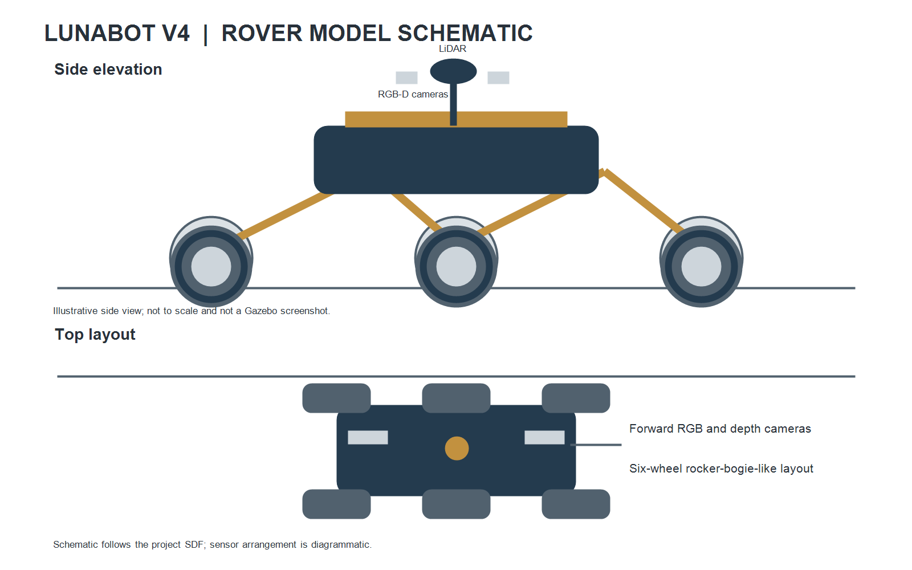

# LunaBot V4
## Terrain-Aware Autonomous Navigation for a Simulated Lunar Rover

**Project report**  
**System:** ROS 2 Humble and Gazebo Sim  
**Evidence updated:** 19 November 2026

## Abstract

LunaBot V4 is a simulated rover project that brings sensing, mapping, terrain assessment, route planning, motion control and mission reporting together in one ROS 2 system. Its six-wheel articulated rover moves through a lunar-inspired Gazebo world without GPS. A LiDAR-based SLAM system builds a map, RGB-D perception labels terrain, and a separate LiDAR detector marks nearby obstacles. A terrain-aware A* planner uses these map layers to choose a route. A path follower sends motion requests through a bounded controller and simulator watchdog.

The final Phase L run on 19 November 2026 exercised the system with an operator-selected goal. The run records a completed mission, an obstacle detection, dynamic replanning, goal arrival, an evaluation pass and a saved map. The odometry monitor recorded 8.124 m of travel over 123.318 seconds of simulation time. The mission status recorded 174 map updates. These results show that the integrated software path worked in that simulation run. They do not establish repeatable performance on physical lunar terrain. Other project results include a held-out three-class perception score of 0.6057 mean intersection over union, a bounded short-route localization comparison, three simulated round trips, and deterministic planner fixtures. Each result applies only to its named dataset, route or test method.

## 1. Introduction

Planetary rovers must travel through uncertain terrain while relying on onboard sensors and local maps. On the Moon, there is no terrestrial GPS signal to guide a rover. Craters, rocks, shadows and changing surface conditions also make route selection difficult. This project uses a simulation to study how several common robotics components can be connected into an autonomous navigation pipeline.

LunaBot V4 is an engineering and education project, not a flight system. Gazebo supplies a lunar-like environment and simulated sensors, while ROS 2 connects the perception, mapping, planning and control nodes. The work focuses on integration: a goal selected by an operator must pass through the map and planning system, produce bounded motion commands, and end in a mission status supported by recorded evidence.

The project was developed through phases A to L. Early phases established the rover model, sensor interfaces, command control and mapping. Later phases added semantic perception, terrain costs, dynamic replanning, evaluation and mission supervision. Phase L brings these parts together for the final demonstration.

## 2. Problem, objectives and scope

The problem addressed is how a simulated rover can reach a selected destination without GPS while responding to terrain and obstacles perceived by its onboard sensors.

The project objectives are to:

- simulate a six-wheel rover in a lunar-inspired environment;
- publish camera, depth, LiDAR, IMU and wheel-odometry data through ROS 2;
- estimate map-relative pose and build an occupancy map with LiDAR SLAM;
- classify terrain and project visual and depth observations into map layers;
- mark nearby obstacles using LiDAR returns;
- plan and replan routes using occupancy and terrain costs;
- constrain rover motion through a single command-control boundary; and
- report mission state and retain evidence from the final demonstration.

The scope is limited to software and simulation. The model uses simplified physics and simulated sensors. The project does not include a physical rover, lunar soil tests, flight hardware, a sample-collection mechanism, or environmental models for vacuum, radiation, dust charging and thermal extremes. A successful simulated mission therefore supports a software integration claim only.

## 3. System overview

The system begins in Gazebo. Simulated RGB and depth cameras, a 2D LiDAR, an IMU and wheel odometry publish data through ROS-Gazebo bridges. `slam_toolbox` combines LiDAR and odometry information to maintain `/map` and the `map` to `odom` transform. The semantic mapper combines image classes, depth and map-relative transforms to produce terrain and geometry layers. The LiDAR obstacle detector publishes a separate obstacle grid.

The cost mapper fuses terrain risk and obstacle information into a planning grid. Weighted A* searches that grid for a route to the operator's goal. The follower tracks the route, checks for stale or blocked inputs and sends velocity requests to `/cmd_vel_in`. The ROS controller validates and limits those requests before publishing `/cmd_vel`; a native simulator watchdog provides an additional timeout before the rover's drive system receives commands.

The Phase L mission supervisor observes map, goal, plan, replanning, obstacle and evaluation evidence. It reports lifecycle state and writes events to a SQLite journal. The supervisor does not control the rover directly; the follower and controller remain responsible for motion.

**Figure 1. Rover layout.** This schematic is based on the project model dimensions and sensor arrangement. It is an explanatory drawing, not a Gazebo screenshot and not a scale rendering.

## 4. Rover and simulated environment

The rover model has a central chassis, six wheels and articulated rocker-bogie-like suspension links. The model source defines a 0.95 m by 0.68 m by 0.22 m chassis collision shape, six wheels with a 0.17 m radius and 0.13 m width, a sensor mast and a differential-drive system. The listed 24 kg value is the chassis-link mass; it is not the total mass of every link and component in the model.

The sensor assembly carries RGB and depth cameras, LiDAR and an IMU. The camera mounts are angled downward for terrain observation. Wheel odometry supplies the local `odom` to `chassis` transform. Static and joint-driven transforms position the sensors relative to the rover. Simulation dimensions, camera intrinsics and rates describe the configured model; they are not measurements from flight hardware.

The Gazebo world contains lunar-like terrain, habitat structures, equipment and physical obstacles, with gravity configured to 1.62 m/s². The map used for a particular run reflects what the simulated sensors observed during that run. Unknown cells must not be interpreted as verified free space.

**Figure 2. Phase L occupancy map.** The image is rendered from the saved occupancy grid produced by run `20261119-211105-phase-l-lunar-design-34687`. The companion PGM and YAML files preserve the original map data and metadata.

The saved map is 285 by 233 cells at 0.05 m per cell, giving a raster extent of approximately 14.25 m by 11.65 m. Its origin is (-6.49, -6.91, 0) m. This describes the saved map artifact, not the full dimensions of the generated world.

## 5. Sensors, localization and mapping

The camera provides RGB imagery and the depth camera provides range values used by the terrain mapper. LiDAR supports both SLAM and the obstacle detector. The IMU is available for diagnostics, while wheel odometry provides a local motion estimate. In the audited Phase B sensor run, the measured simulation-time rates were approximately 19.71 Hz for RGB, 14.48 Hz for depth, 10 Hz for LiDAR, 100 Hz for the IMU and 29.41 Hz for odometry. These are results from that specific contract audit, not a guarantee for every computer or launch mode.

`slam_toolbox` builds a two-dimensional occupancy map and publishes the `map` to `odom` correction. The wheel system owns `odom` to `chassis`. This separation lets SLAM correct the global estimate while the drive system continues to report local motion. A Phase C short-route comparison measured 0.2299 m position error and 0.000053 rad heading error against Gazebo truth. The position result was close to its 0.25 m gate, and the test covered only one bounded route. It should not be read as a general localization accuracy figure.

The semantic mapper projects terrain observations into map-aligned grids. The active perception path uses three classes: regolith, rock and shadow, with an unknown state for uncertain or unavailable observations. Geometry-derived layers include slope, roughness, crater risk and uncertainty. The mapper and cost system treat unknown or shadowed regions cautiously rather than claiming that they are confirmed obstacles. Occupancy and terrain risk remain separate inputs that are combined for planning.

## 6. Terrain perception and route planning

The project evaluates a three-class learned perception model on a held-out analog dataset containing 749 records. The reported mean intersection over union is 0.6057. Per-class scores were 0.9181 for regolith, 0.3691 for rock and 0.5300 for shadow. The lower rock score shows that the overall average hides class-specific weakness. These figures describe one checkpoint and dataset; they do not demonstrate performance across lunar imagery, hardware cameras or untested lighting conditions.

RGB-D observations are projected into map coordinates using camera information and transform data. Separate terrain layers represent semantic labels and geometric risk. A cost mapper combines those layers with LiDAR obstacle cells. The costs are configurable engineering penalties, not a calibrated model of wheel slip, sinkage, rollover or stopping distance. The rover footprint and obstacle inflation settings make the planner avoid cells around known hazards, but a path that avoids a grid cell is not proof of physical clearance.

The active planner is weighted A* on a grid. Its step cost increases with terrain risk, so a longer route may be selected when it avoids higher-cost cells. New map or obstacle information can invalidate a route and trigger replanning. D* Lite was benchmarked as a candidate but was not retained in the live route path; the documented fixture run found it slower than weighted A*. Nav2 is also not part of the current custom planner pipeline.

## 7. Motion control and safety boundary

The path follower converts a planned route into velocity requests. It checks path freshness and evaluates the remaining route against current obstacle information. If an obstacle blocks the route, the follower stops while a replacement plan is requested. Stale maps, unsafe state and missing mission heartbeat also inhibit motion.

All motion passes through a single control boundary. The controller checks values, limits speed and angular rate, applies acceleration constraints and includes a 0.5-second command watchdog. A separate native Gazebo watchdog provides an additional actuator timeout. This layered arrangement reduces the chance that stale or invalid commands continue to drive the simulated rover. It is a software safety measure for the simulation and is not a certified safety system for physical hardware.

## 8. Phase L final mission

Phase L adds the final mission supervisor and joins the earlier perception, mapping, planning, control and evaluation components into a goal-driven demonstration. The presentation mode is designed for an operator to choose a goal in RViz. The automated regression mode can use a test goal, but the final operator demonstration uses manual goal selection.

The mission moves through states that include waiting for a map, waiting for a goal, ready, active and completed. A goal is accepted only when it has a valid frame and finite pose values. The map is checked for valid dimensions, resolution, data length and occupancy values. A changed goal receives a new identifier so that evidence from an earlier goal cannot satisfy the new attempt. Pause, resume, cancel, recovery and emergency-stop commands are available through the supervisor interface. Motion remains gated by the mission status and stops if that status becomes stale.

Mission completion requires evidence of a valid map and goal, a terrain plan, dynamic-replanning success, goal arrival, an evaluation pass and LiDAR obstacle detection. Manual presentation mode also requires an operator-selected goal. Lifecycle transitions and delivery events are recorded in SQLite. The event journal makes the software state auditable; it does not represent a physical science payload or sample collection.

### Latest recorded Phase L run

Run `20261119-211105-phase-l-lunar-design-34687` used the lunar-design rover model in the WSL software-rendered presentation profile. Its evidence records:

- a manually selected goal and a final `MISSION_DEMO_PASS` state;
- LiDAR obstacle detection and `DYNAMIC_REPLAN_PASS`;
- safe goal arrival at 0.24 m from the requested target;
- `EVALUATION_PASS`, with 3,746 input-motion samples and 10,608 output-motion samples;
- 174 map updates in the final mission status;
- 8.124 m accumulated odometry distance over 123.318 seconds of simulation time;
- a saved 0.05 m-resolution occupancy map and a clean launcher shutdown.

This is one successful simulated mission. The run used a WSL presentation profile and does not qualify the target workstation, physical rover or repeated mission reliability. The run log marked one dashboard map-update presentation check as “not evaluated” at its capture point, even though the later mission log recorded completion and map updates. The report therefore uses the mission and map artifacts for the demonstrated software result, while leaving GUI presentation qualification as a separate item. A process-timing value in the replanning monitor was affected by the presentation run's timing conditions and is not used here as a representative latency measurement.

## 9. Results across the project

| Evaluation | Result | What the result supports |
|---|---|---|
| Sensor contract audit | RGB 19.71 Hz; depth 14.48 Hz; LiDAR 10 Hz; IMU 100 Hz; odometry 29.41 Hz | Simulated stream rates and message contracts in the named Phase B run. |
| Short-route SLAM comparison | Position error 0.2299 m; heading error 0.000053 rad | Bounded localization comparison on one route against Gazebo truth. |
| Held-out perception evaluation | 749 records; mIoU 0.6057 | Performance on the named analog dataset and checkpoint. |
| Geometry calibration | Four seeded captures; horizontal p95 0.0219 m at 1.5-3 m and 0.0576 m at 3-5 m | Projection calibration in the tested simulator setup. |
| Round-trip missions | 3 of 3 round trips; 9 of 9 legs; 3 durable delivery records | Repeatability on one committed map and profile. “Delivery” is a software event. |
| Planner fixtures | 15 of 15 attempts passed; terrain paths avoided all 6 configured hazard-region intersections | Deterministic grid fixtures, not live physical clearance. |
| Final Phase L demonstration | Mission pass, obstacle detection, replan pass, goal arrival and map saved in the 19 November run | End-to-end integration for the specific simulated run. |

The experiment ledger keeps unlike measurements separate. Planner fixture pass rates are not live rover success rates; planned grid lengths are not traveled distances; and model-only inference timing is not whole-stack performance. Collision count, physical clearance, general mission recovery rate, long-route localization error and whole-stack CPU/GPU load remain unmeasured in the cited cross-trial evaluation.

## 10. Limitations and interpretation

The final run demonstrates integration under one simulated scenario. It does not show that every launch profile or every mission will succeed. The latest run uses software rendering and relaxed scheduling limits intended for WSL. Its behavior must not be presented as equivalent to a target workstation benchmark.

The simulation does not reproduce lunar vacuum, dust, temperature extremes, radiation or validated soil mechanics. The rover's wheel-ground interaction and terrain costs are not calibrated against a physical vehicle. The perception model is evaluated on an analog held-out set rather than on lunar surface imagery. The SLAM accuracy result is limited to a short route. The 2D planning grid does not provide a full three-dimensional rollover or terrain-support analysis.

Several operational metrics still need instrumentation: collision and contact counts, minimum footprint clearance, actual trajectory error, mission duration across comparable trials, recovery outcomes and resource use for the full ROS-Gazebo stack. A stronger final acceptance study should repeat manual missions in clean runs, preserve exact run IDs and input samples, and measure these outcomes rather than infer them from a passing status string.

## 11. Conclusion

LunaBot V4 now connects simulated sensing, SLAM, RGB-D terrain mapping, LiDAR obstacle detection, weighted A* planning, route following, bounded control and mission evidence in one ROS 2/Gazebo system. The 19 November Phase L run records the complete path from a manually selected goal through obstacle-aware replanning to goal arrival and mission completion. The run also produced a saved occupancy map and odometry evidence.

The project's main contribution is this inspectable integration and its phase-specific evidence, not a new planning algorithm or a claim of flight readiness. The measured results support limited claims about the named simulation runs, fixtures and datasets. Physical rover trials, wider repeated acceptance, calibrated terrain mobility and the currently unmeasured safety and performance metrics remain necessary before stronger operational claims would be justified.

## References

1. ROS 2 Humble documentation. https://docs.ros.org/en/humble/
2. Open Robotics, Gazebo Sim documentation. https://gazebosim.org/docs/
3. `slam_toolbox` documentation. https://github.com/SteveMacenski/slam_toolbox
4. P. E. Hart, N. J. Nilsson and B. Raphael, “A Formal Basis for the Heuristic Determination of Minimum Cost Paths,” *IEEE Transactions on Systems Science and Cybernetics*, 4(2), 100-107, 1968. https://doi.org/10.1109/TSSC.1968.300136
5. S. Koenig and M. Likhachev, “D* Lite,” *Proceedings of the AAAI Conference on Artificial Intelligence*, 2002, pp. 476-483. https://aaai.org/papers/00476-aaai02-072-d-lite/
6. NASA/JPL, “NASA's Self-Driving Perseverance Mars Rover Takes the Wheel,” 2021. https://www.nasa.gov/solar-system/nasas-self-driving-perseverance-mars-rover-takes-the-wheel/
7. NASA/JPL, “Surface System Software and Rover Navigation” (Mars Science Laboratory). https://www-robotics.jpl.nasa.gov/what-we-do/flight-projects/mars-science-laboratory/surface-system-software-and-rover-navigation/
8. LunaBot V4 source and evidence: `src/lunabot_gazebo/models/lunabot_lunar_design/model.sdf`, `src/lunabot_gazebo/worlds/lunar_world.sdf`, and `evidence/runs/20261119-211105-phase-l-lunar-design-34687/`.
